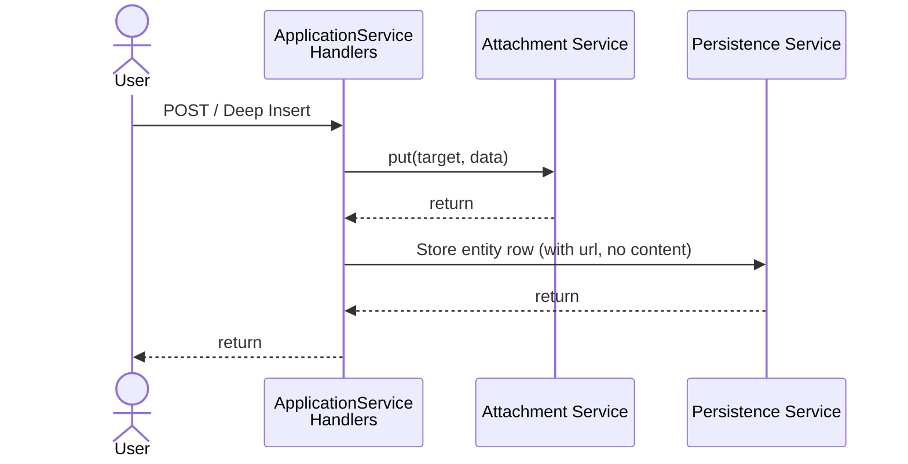
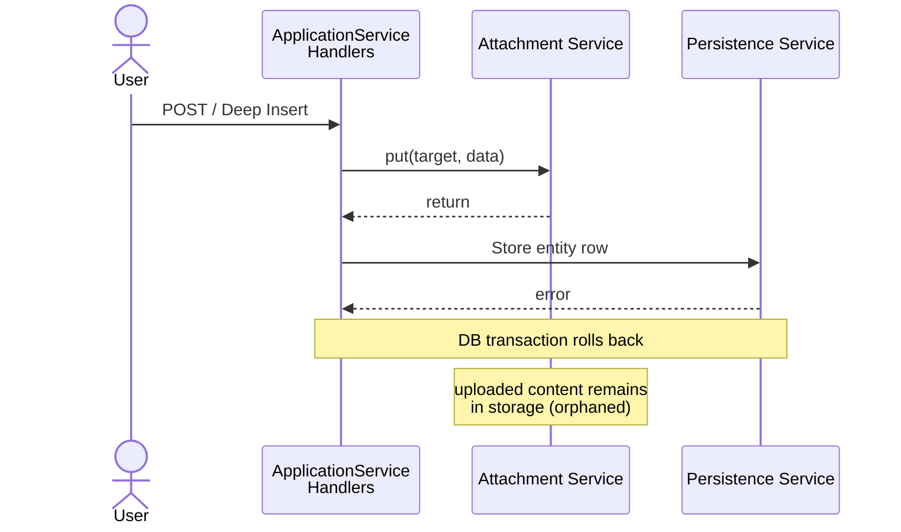
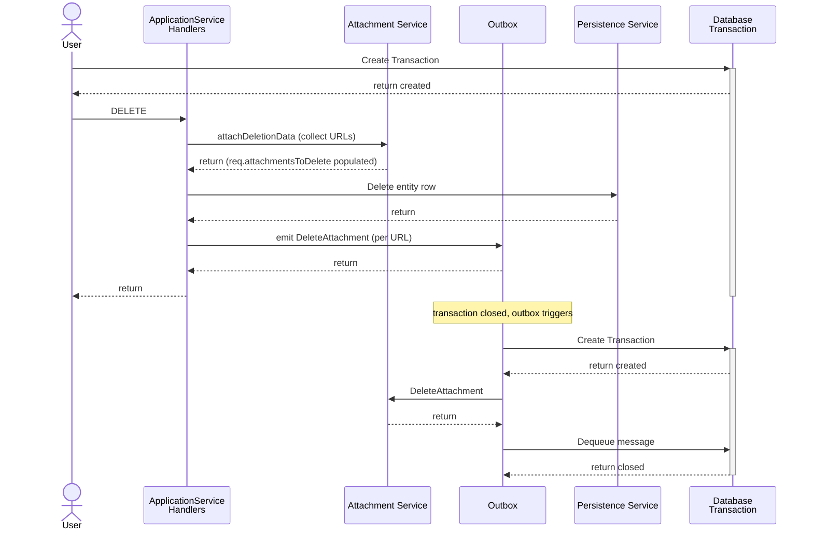
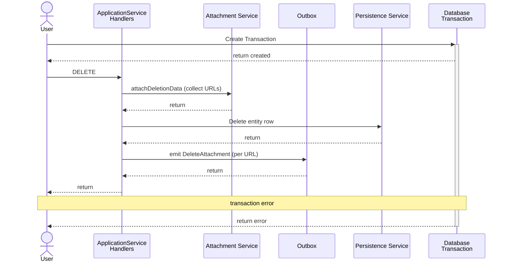
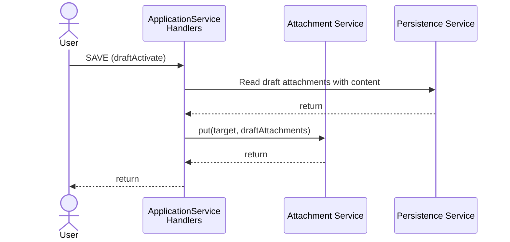
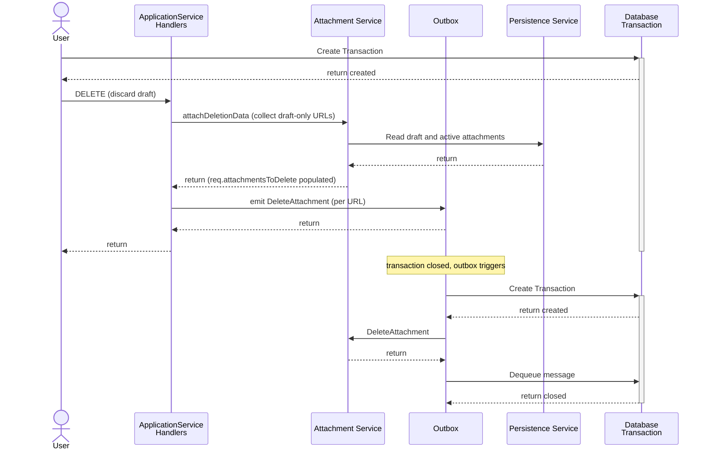
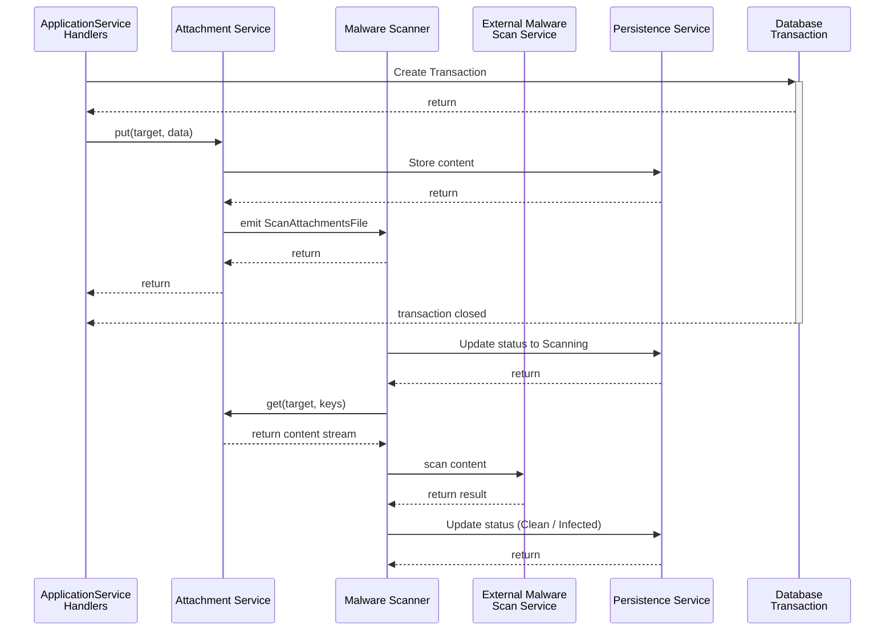
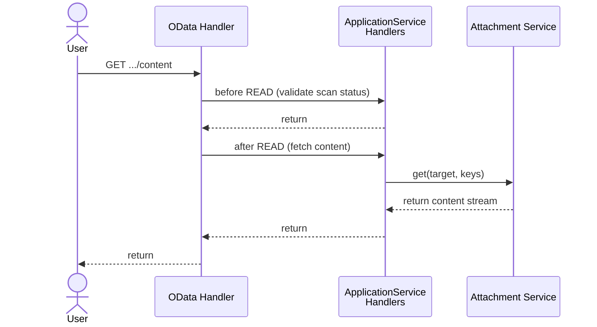
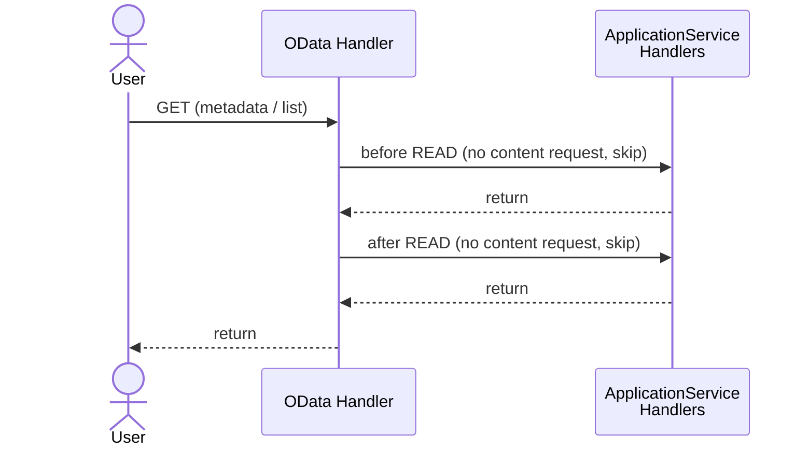

# Processes

The following processes describe the steps to create, read, update and delete contents in the
attachment entity. The attachment entity itself is handled by the CAP stack as it is part of the
data model.

The attachment service has the following events. This document describes how these events are
emitted.

- `PUT` (create or replace content)
- `DELETE`
- `GET` (read content)

The following chapters describe the processes for user events and how they map to the attachment
service events.

## Create

The following overview shows the process of creating new content inside the attachment entity.

### Success

The handler is registered on the `CREATE` event of every `ApplicationService` that has attachment
entities. It calls `AttachmentService.put()` with the attachment data, which includes the content
stream and the generated URL (used as the object store key). The attachment service uploads
the content to storage. The entity row is then persisted by the CAP framework with the `url` field
set but no `content` stored in the DB (for object store backends).

For the DB backend the flow is identical except the content is written into the `content` column of
the attachment entity row rather than to an external store.

### Error

If the DB transaction rolls back after the content has already been uploaded to external storage,
the uploaded content is left as an orphan. Unlike the Java implementation, the Node.js plugin has
no post-rollback cleanup mechanism on the create path — there is no equivalent of the Java
`CreationChangeSetListener`.

## Delete

The following overview shows the process of deleting existing content inside the attachment entity.

### Success

The `before DELETE` handler calls `attachDeletionData`, which queries the DB for the URLs of all
attachments about to be deleted and stores them on the request as `req.attachmentsToDelete`. After
the CAP framework deletes the entity row, the `after DELETE` handler emits a `DeleteAttachment`
event for each URL. Because the attachment service is configured as an outboxed service, the emit
is written to the outbox table within the same DB transaction. The outbox processes the actual
storage deletion asynchronously after the transaction commits.

### Error

If the DB transaction rolls back, the outbox entry is rolled back with it. The storage delete is
never triggered, leaving the content intact and consistent with the entity row that was also
rolled back.

## Draft

Attachments are draft-enabled. This means that attachments can be created, updated, and deleted
in draft mode.

In draft mode, attachment rows are written to the draft shadow table. Content is always stored in
the draft shadow table (DB) during draft editing, regardless of the configured storage backend.
For object store backends, content is moved from the draft shadow table to external storage when
the draft is activated.

This is a fundamental difference from the Java implementation, where content is written directly
to the final storage backend even during draft editing.

### Activate Draft

When the draft is activated (`SAVE`), the `after SAVE` handler calls `draftSaveHandler`, which
reads all attachment rows with content from the draft shadow table and calls
`AttachmentService.put()` for each one. This copies the content from the draft shadow table to
the active entity (and to external storage for object store backends). A malware scan is triggered
as part of `put()`.

For attachments deleted during draft editing, `attachDraftCompositionDeletionData` compares the
draft and active attachment lists. Any attachment present in the active entity but absent from the
draft is collected into `req.attachmentsToDelete` and deleted from storage via the outbox in the
`after DELETE/UPDATE` handler.

### Cancel Draft

When a draft is discarded, `attachDraftCompositionDeletionData` collects URLs of draft-only
attachments — those present in the draft shadow table but with no active counterpart
(`HasActiveEntity: false`). These are emitted as `DeleteAttachment` events via the outbox.

## Malware Scan

For uploaded content a malware scan is required. The scan is triggered asynchronously after
upload and does not block the upload response.

### Status

The attachment entity has a `status` field indicating the scan status. The default value is
`Unscanned`. All possible values are:

- `Unscanned` — content has not been scanned yet
- `Scanning` — content is currently being scanned
- `Clean` — content was scanned and found to be clean
- `Infected` — content was scanned and found to be infected
- `Failed` — an error occurred during scanning

### Scan Flow

After content is uploaded, `AttachmentService.put()` emits a `ScanAttachmentsFile` event on the
malware scanner service. Because the malware scanner is an outboxed service, the scan is triggered
asynchronously after the current transaction closes.

The malware scanner sets the status to `Scanning`, fetches the content via
`AttachmentService.get()`, and streams it to the external SAP Malware Scanning Service. On
completion, the status is updated to `Clean` or `Infected`.

If the scan result is `Infected`, the malware scanner emits `DeleteInfectedAttachment` on the
attachment service, which nulls out the content and url fields in the DB and deletes the file
from storage.

If no external scanner is configured, the mocked scanner used in development sets the status to
`Clean` immediately.

### Scan Expiry and Re-scan on Download

When a content download is requested, the `before READ` handler checks the attachment's scan
status and `lastScan` timestamp. A re-scan is triggered and the client receives HTTP 202
(scan in progress, content not yet available) if:

- the status is `Unscanned`, or
- the `lastScan` timestamp is older than `scanExpiryMs` (default: 3 days)

A download is blocked with HTTP 403 if the status is anything other than `Clean` (i.e.
`Scanning`, `Infected`, or `Failed`).

## Read

The `after READ` handler only fetches content from the attachment service when the request URL
ends with `/content` (i.e. an actual file download). For metadata reads — e.g. listing attachments
to show links on the UI — the handler returns without calling the attachment service.

This achieves the same goal as the lazy `InputStream` proxy in the Java implementation, but
through a simpler mechanism: a URL check in the handler rather than a proxy object.

### Read including Access to the Content

### Read without Access to the Content

